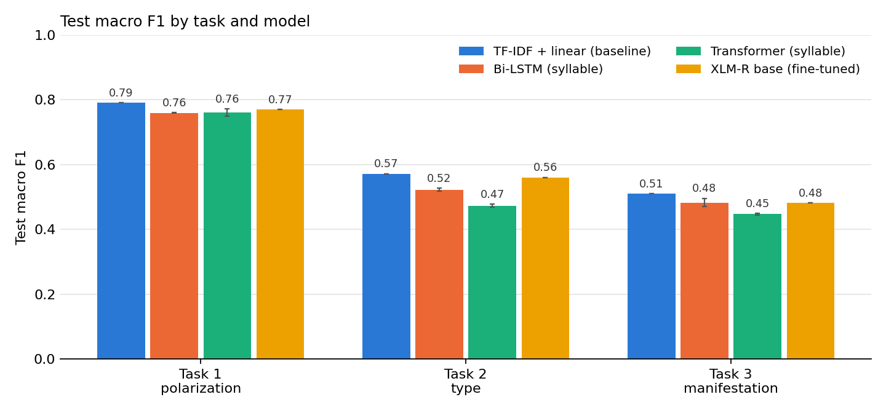

# myPolar: Polarization Detection, Type Classification and Manifestation Identification

Group 3 submission for Assignment 7 (AI Engineering Fundamental, Batch 2). We merged the class's Assignment-2 myPolar annotations into one dataset and compared a traditional ML baseline with a Bi-LSTM, a Transformer trained from scratch, and a fine-tuned XLM-RoBERTa on the three [POLAR @ SemEval-2026 Task 9](https://polar-semeval.github.io/tasks.html) subtasks.

| Task | Question | Type | Labels |
|---|---|---|---|
| 1 | Is the sentence polarized? | binary | `polarization` |
| 2 | What kind of polarization? | multi-label | `political`, `racial/ethnic`, `religious`, `gender/sexual`, `other` |
| 3 | How is it expressed? | multi-label | `stereotype`, `vilification`, `dehumanization`, `extreme_language`, `lack_of_empathy`, `invalidation` |

## Folder contents

| Path | What it is |
|---|---|
| [final/raw-combined.csv](final/raw-combined.csv) | Stage 1: every contributor's file in one format, with `source` (resource link) and `annotator_file` |
| [final/final_dataset.csv](final/final_dataset.csv) | Merged dataset with all labels and `key_phrase` |
| [final/task1_polarization.csv](final/task1_polarization.csv), [task2_type.csv](final/task2_type.csv), [task3_manifestation.csv](final/task3_manifestation.csv) | Stage 2: de-duplicated model-ready files (`id`, `text`, labels) |
| [baseline_traditional_ml/](baseline_traditional_ml/) | TF-IDF + Logistic Regression / Linear SVM notebook and the train / val / test `splits/` used by every model |
| [deep_models/](deep_models/) | Bi-LSTM, Transformer and XLM-R training code, result files, logs, the comparison notebook, and the error analysis |
| [assignment-7-thein-kyaw-lwin/](assignment-7-thein-kyaw-lwin/) | Thein Kyaw Lwin's multi-task experiment (XLM-R, mBERT, word and syllable Bi-LSTM, trained on Kaggle) with its own cleaning, split and tokenizer notes; see [Multi-task experiment](#multi-task-experiment-thein-kyaw-lwin) |
| [myPolar_Assignment7_G3.pptx](myPolar_Assignment7_G3.pptx) | Presentation slides with speaker notes |
| `myPolar_dataset.zip`, `baseline_traditional_ml.zip`, `assignment-7-thein-kyaw-lwin.zip` | Zipped copies of `final/`, `baseline_traditional_ml/` and `assignment-7-thein-kyaw-lwin/` |

## Data

**Stage 1** (`raw-combined.csv`, 12,010 rows from 25 files) keeps provenance: `original_id`, `source`, `annotator_file`, `key_phrase` and all 12 labels.

**Stage 2** (task files) keeps only what a model needs.

| File | Rows | Positives |
|---|---|---|
| `task1_polarization.csv` | 10,710 | polarized 5,492 / not polarized 5,218 |
| `task2_type.csv` | 10,710 | political 2,655 · other 1,572 · racial/ethnic 904 · gender/sexual 651 · religious 389 |
| `task3_manifestation.csv` | 10,116 | vilification 3,095 · extreme_language 1,826 · invalidation 1,636 · stereotype 1,340 · lack_of_empathy 1,147 · dehumanization 976 |

Processing between the stages:

- **Duplicates removed.** 1,000 rows with identical text were dropped (11,710 to 10,710), so no sentence can appear in both train and test.
- **Labels made consistent.** Type and manifestation labels are cleared on rows marked not polarized (about 1,900 and 370 rows).
- **Task 3 is smaller.** Two contributor files have no manifestation labels, so their rows are left out of Task 3.
- **Splits.** 80 / 10 / 10 train / val / test, stratified, made separately for each task.

## Models

| Model | Input | Notes |
|---|---|---|
| TF-IDF + LogReg / LinearSVC (baseline) | word 1–2-grams, char 2–5-grams | C chosen on validation |
| Bi-LSTM | syllables | 2 layers, 128 hidden units per direction, mean + max pooling, trained from scratch |
| Transformer | syllables | 3 encoder layers, 4 heads, d = 192, trained from scratch |
| XLM-RoBERTa base | subwords, spaces between Myanmar characters removed | fine-tuned for 4 epochs at lr 2e-5; token embeddings frozen to fit in 16 GB |

The contributors segmented their text differently (word-segmented, phrase-segmented, or not at all), so the neural models ignore the original spacing: the Bi-LSTM and Transformer re-tokenise into syllables, and XLM-R reads unsegmented text.

All models share the same splits and protocol: the hyperparameter or epoch is chosen on validation macro F1, and the test set is scored once at that point. Task 1 macro F1 is over the two classes; Tasks 2 and 3 are macro over the labels. Positive classes are up-weighted in every model and the decision threshold is 0.5.

## Results

Test macro F1 on the shared random splits. Bi-LSTM and Transformer are the mean ± standard deviation of 3 seeds; the baseline and XLM-R are single runs.

| Model | Task 1 polarization | Task 2 type | Task 3 manifestation |
|---|---|---|---|
| TF-IDF + linear (baseline) | **0.790** | **0.572** | **0.509** |
| Bi-LSTM | 0.759 ± 0.001 | 0.522 ± 0.005 | 0.482 ± 0.013 |
| Transformer (from scratch) | 0.760 ± 0.012 | 0.473 ± 0.005 | 0.447 ± 0.003 |
| XLM-RoBERTa base (fine-tuned) | 0.770 | 0.560 | 0.481 |



Task 1 with whole contributors held out (validation and test contributors never seen in training; one split, one seed):

| Model | Random split | Unseen contributors | Drop |
|---|---|---|---|
| TF-IDF + linear (char, LogReg) | 0.790 | 0.602 | 0.188 |
| Bi-LSTM | 0.759 | **0.662** | 0.097 |
| Transformer (from scratch) | 0.760 | 0.629 | 0.131 |
| XLM-RoBERTa base (fine-tuned) | 0.770 | 0.658 | 0.112 |

Per-label scores, validation scores and selected epochs are in [deep_models/results_comparison.ipynb](deep_models/results_comparison.ipynb).

### Findings

1. **The TF-IDF baseline was not beaten on the random splits.** It leads on all three tasks. XLM-R comes closest (0.02 behind on Task 1, 0.01 on Task 2); the Bi-LSTM is about 0.03 to 0.05 behind.
2. **A Transformer trained from scratch is the weakest model** on the two multi-label tasks. About 8,500 training sentences are too few for it without pre-training.
3. **Scores fall for every model on unseen contributors,** by 0.10 to 0.19, and the ranking reverses: the baseline drops the most (0.790 to 0.602) while the Bi-LSTM and XLM-R hold up best (about 0.66). The polarization rate ranges from 0% to 99% between contributors, so on a random split part of the score comes from recognising a contributor's source and writing style, and character n-grams are the best at that.
4. **Difficulty rises from Task 1 to Task 3.** Detecting polarization reaches about 0.79, naming its type about 0.57, and identifying how it is expressed about 0.51.
5. **Explicit labels are easier than implicit ones.** `political` and `vilification` reach 0.65 to 0.69 for the best models, while `stereotype`, `lack_of_empathy` and `invalidation` stay below 0.47 for every model. XLM-R is the best model on `gender/sexual` (0.64 vs 0.60) and `vilification` (0.67 vs 0.65).
6. **Small differences are within noise.** The test sets have about 1,000 sentences, and XLM-R's validation and test scores on Task 1 differ by 0.04 (0.811 vs 0.770), so gaps of 0.01 to 0.02 between models should not be read as real.

Caveats: XLM-R was run once per task with no hyperparameter search and with frozen token embeddings because of memory limits, so its numbers are a lower bound on what fine-tuning can do. The unseen-contributor XLM-R run used a 5-epoch schedule instead of 4. Training on MPS is not exactly repeatable: re-running the Bi-LSTM with seed 42 for the error analysis gave 0.758 / 0.534 / 0.477 against 0.759 / 0.519 / 0.468 in the first run.

## Error analysis

Produced by [deep_models/error_analysis.py](deep_models/error_analysis.py); every table is saved in [deep_models/results/error_analysis/](deep_models/results/error_analysis/). All numbers are on the test sets, single runs (seed 42).

### Word, syllable or character?

Test macro F1 with the same classifier and only the input unit changed.

| Input unit | TF-IDF T1 | TF-IDF T2 | TF-IDF T3 | Bi-LSTM T1 | Bi-LSTM T2 | Bi-LSTM T3 |
|---|---|---|---|---|---|---|
| Word (whitespace tokens) | 0.751 | 0.410 | 0.438 | 0.728 | 0.389 | 0.425 |
| Syllable | **0.785** | 0.549 | 0.475 | **0.758** | **0.534** | **0.477** |
| Character | 0.782 | **0.572** | **0.509** | 0.729 | 0.470 | 0.436 |

- **Words are the worst unit for both models,** by 0.03 on Task 1 and by up to 0.16 on Task 2. Contributors segmented their text differently, so the same word appears as different whitespace tokens: 34% of the word tokens in the test set are unknown to a vocabulary built from the training set, against 0.8% of syllables and 0% of characters.
- **TF-IDF works best with character n-grams, the Bi-LSTM with syllables.** Character n-grams of length 2 to 5 already cover syllables and short words. For the Bi-LSTM, characters make the sequences about three times longer and it does worse.
- Removing the spaces before taking character n-grams did not help (0.782 on Task 1, 0.545 on Task 2, 0.487 on Task 3).

### Task 1: where the errors are

The TF-IDF baseline makes 225 errors on 1,071 test sentences (108 false positives, 117 false negatives); the Bi-LSTM makes 259 (137 and 122).

| Group | n | TF-IDF accuracy | Bi-LSTM accuracy |
|---|---|---|---|
| 1–15 syllables | 148 | 0.736 | 0.682 |
| 16–30 syllables | 345 | 0.757 | 0.762 |
| 31–60 syllables | 390 | 0.821 | 0.782 |
| 61+ syllables | 188 | 0.830 | 0.761 |
| Word-segmented text | 504 | 0.829 | 0.752 |
| Phrase-segmented text | 434 | 0.772 | 0.779 |
| Unsegmented text | 133 | 0.699 | 0.714 |

- **Short sentences are the hardest** for both models. Up to 30 syllables, about one in three non-polarized sentences is flagged as polarized.
- **TF-IDF depends on segmentation; the Bi-LSTM does not.** On unsegmented text TF-IDF misses 55% of the polarized sentences. The Bi-LSTM reads syllables and ignores the spacing, and its accuracy stays between 0.71 and 0.78. Segmentation style goes together with contributor and source, so this is not a pure effect of spacing.
- **Accuracy per contributor ranges from 0.50 to 0.98.** It is highest where one class dominates (0.98 for a contributor with no polarized sentences) and lowest for `mya_hanzawhtet` (0.50) and `mya_myothet` (0.52), where the baseline misses 69% and 75% of the polarized sentences.
- **Polarized sentences without a type or manifestation label are found only about half the time** (recall 0.48 to 0.55, against 0.74 to 0.92 for the labelled ones). The baseline finds `religious` polarization most easily (recall 0.89) and `other` and `racial/ethnic` least (0.77).
- **The strongest character n-grams are partly style, not content.** Insults and violent words (ခွေး, သတ်, ဖာ) point to polarized, but the strongest non-polarized features are sentence endings and punctuation of formal news writing (တယ်။, ၏။, brackets). The model partly separates news style from social-media style.
- **The two models fail on different sentences.** Both are wrong on 136; one of the two is right on another 212. If the right model could always be picked, accuracy would be 0.873, so an ensemble has room to improve.
- **Some errors look like label noise.** Among the most confident errors ([confident_errors.csv](deep_models/results/error_analysis/confident_errors.csv)) there are sentences with open insults labelled non-polarized and plain news sentences labelled polarized. We read only a sample and did not re-annotate.

### Tasks 2 and 3: per-label errors (TF-IDF baseline)

- **The models over-predict.** Every label has more false positives than false negatives, a result of the balanced class weights. `other` is predicted 263 times for 157 true cases (precision 0.39).
- **Task 2 misses are mostly silent.** When `political`, `racial/ethnic`, `gender/sexual` or `other` is missed, about half the time no type is predicted at all. Missed `religious` is given `political` instead in 56% of cases, and missed `gender/sexual` is given `other` in 44%.
- **Task 3 labels are confused with each other.** Missed `dehumanization` is predicted as `vilification` in 64% of cases and missed `lack_of_empathy` in 59%. These labels often occur together and share vocabulary.
- **Exact match** (all labels of a sentence correct) is 0.57 on Task 2 and 0.47 on Task 3.

## Multi-task experiment (Thein Kyaw Lwin)

[assignment-7-thein-kyaw-lwin/](assignment-7-thein-kyaw-lwin/) is a second, independent experiment on the same `final_dataset.csv`. One model predicts all three tasks at once (a shared encoder with three output heads), trained on a Kaggle T4 GPU.

Differences from the main experiment:

| | Main experiment | Multi-task experiment |
|---|---|---|
| Rows | 10,710 / 10,710 / 10,116 (per task) | 10,068 (all tasks) |
| Cleaning | exact-text duplicates removed | also drops rows without `original_id` (1,200), rows missing any label, and duplicates with conflicting polarization; duplicates matched ignoring spaces |
| Text | original spacing | re-segmented into words with `mmdt-tokenizer` |
| Type / manifestation on non-polarized rows | cleared | kept (1,903 non-polarized rows carry a type) |
| Split | separate 80 / 10 / 10 split per task | one multi-label stratified 80 / 10 / 10 split |
| Models | one model per task | one model for all three tasks; epoch chosen on validation macro F1 averaged over the tasks |

About half of his test sentences are in our training splits, so his scores cannot be put in the main results table. To compare the two, our TF-IDF baseline (same features, models and C grid, C chosen on validation) was trained and scored on his split with [deep_models/tkl_split_comparison.py](deep_models/tkl_split_comparison.py). His runs were rescored from their saved test predictions and match his reported numbers.

Test macro F1 on his split (1,007 test sentences, single runs):

| Model | Task 1 | Task 2 | Task 3 |
|---|---|---|---|
| TF-IDF + linear (our baseline) | 0.733 | 0.583 | 0.456 |
| XLM-RoBERTa base, no class weights | **0.772** | 0.261 | 0.159 |
| XLM-RoBERTa base | 0.769 | 0.556 | 0.449 |
| mBERT (cased) | 0.760 | 0.565 | 0.448 |
| Bi-LSTM + attention, words | 0.686 | 0.481 | 0.392 |
| Bi-LSTM + attention, syllables | 0.734 | **0.604** | **0.461** |

Per-label scores are in [deep_models/results/tkl_split_comparison.csv](deep_models/results/tkl_split_comparison.csv); his logs, predictions and per-epoch validation scores are in [assignment-7-thein-kyaw-lwin/kaggle/output/](assignment-7-thein-kyaw-lwin/kaggle/output/).

What it adds to the main findings:

1. **On this split the baseline is beaten.** XLM-R leads Task 1 by 0.04 and the syllable Bi-LSTM leads Task 2 by 0.02; Task 3 is a tie. The baseline's Task 1 score falls from 0.790 on our split to 0.733 here. Part of the reason is that the 1,200 rows he dropped (no `original_id`) were among the easiest for the baseline (Task 1 accuracy 0.93 on our test set). Spacing-only duplicates between train and test are not the cause: there are at most 4 in either split.
2. **Class weights are essential for Tasks 2 and 3.** Without them XLM-R predicts almost no minority labels (Task 2 0.26, Task 3 0.16); with them it reaches 0.56 and 0.45. Task 1 does not change.
3. **Syllables beat words for the Bi-LSTM again** (+0.05 to +0.12), which confirms our input-unit comparison on a different split and a different word segmenter.
4. **XLM-R and mBERT are within 0.01 of each other** on every task. [tokenizer.md](assignment-7-thein-kyaw-lwin/tokenizer.md) compares how their tokenizers split Myanmar text.
5. **The ranking between models changes with the split,** while the gaps stay at 0.01 to 0.04. Together with finding 6 above, model differences of this size should be read as uncertain.

## How to reproduce

```bash
pip install torch transformers scikit-learn pandas matplotlib

# 1. Baseline: run baseline_traditional_ml/baseline_traditional_ml.ipynb

# 2. Neural models (results are appended to deep_models/results/*.csv)
cd deep_models
python polar_models.py --model bilstm      --task all --seeds 42 43 44 --out results/bilstm.csv
python polar_models.py --model transformer --task all --seeds 42 43 44 --out results/transformer.csv
python polar_models.py --model xlmr        --task all --seeds 42       --out results/xlmr.csv

# 3. Unseen-contributor check for Task 1
python contributor_holdout.py
for m in bilstm transformer xlmr; do
  python polar_models.py --model $m --task task1 --splits splits_contributor --out results/contributor_holdout.csv
done

# 4. Tables and figure: run deep_models/results_comparison.ipynb

# 5. Error analysis: Bi-LSTM with word / syllable / character input, then the tables
for t in task1 task2 task3; do for u in syllable word char; do
  python polar_models.py --model bilstm --task $t --unit $u --save_preds results/predictions --out results/unit_ablation_bilstm.csv
done; done
python error_analysis.py

# 6. Multi-task experiment: our baseline on Thein Kyaw Lwin's split, and his runs rescored
python tkl_split_comparison.py
```

The multi-task models themselves are trained with the Kaggle kernels in `assignment-7-thein-kyaw-lwin/kaggle/` (`preprocess.py` builds `data/` first, and needs `mmdt-tokenizer` and `iterative-stratification`).

Trained on an Apple M4 (16 GB) with PyTorch MPS. The Bi-LSTM and Transformer take 2–8 minutes per run; XLM-R takes about 20–30 minutes per task.

## Known limitations

- **Provenance gaps.** Row `id`s were renumbered between `raw-combined.csv` and `final_dataset.csv`, so the two files must be joined on `original_id` or text, not `id`. `final_dataset.csv` contains 300 `mya_hanzawhtet` rows that are not in the raw file, the raw file contains 600 `mya_AUNGKOKOO` rows that are not in the final file, and two contributor files have no `original_id`.
- **Seven ids differ** between `task3_manifestation.csv` and the other two task files for the same sentence.
- **Conflicting duplicates.** 32 duplicated sentences had different polarization labels from different contributors; 24 rows in `task1_polarization.csv` therefore differ from `final_dataset.csv`.
- **Incomplete labels.** 342 polarized rows have no type and 568 have no manifestation.
- **Splits differ per task.** A sentence in the Task 3 test set can be in the Task 1 training set, so these splits should not be used for multi-task training.
- **Single annotation.** Almost every sentence was labelled by one person. The only double-annotated set (599 sentences, two contributors) agrees closely on polarization (Cohen's kappa 0.97).

---

## Assignment brief

- ဆရာတို့ [Assignment-2](https://github.com/ye-kyaw-thu/AIE-F-B2/tree/main/assignment/assignment-2) အနေနဲ့ ပြင်ဆင်ခဲ့ကြတဲ့ myPolar ဒေတာ အကြမ်းကိုပဲ သုံးပြီး Task-1, Task-2, Task-3 လုပ်ကြည့်ကြရအောင်။
- Task-1, Task-2, Task-3 နဲ့ ပတ်သက်ပြီး  ဒီလင့်ကို [https://polar-semeval.github.io/tasks.html](https://polar-semeval.github.io/tasks.html) refer လုပ်ပါ။
- အတန်းထဲမှာ ရှင်းပြခဲ့သလိုပဲ နည်းနည်း ခေါင်းစားမယ့် အပိုင်းက တစ်ယောက်ချင်းစီ ပြင်ဆင်ထားတဲ့ ဒေတာတွေကို အရင်ဆုံး format ညှိရမယ့် အပိုင်းပါ။ ဘယ်စာကြောင်းက ဘယ်သူက ပြင်ဆင်ထားတယ်ဆိုတဲ့ information လည်း ပါဝင်ပါစေ။ ဆရာ နားလည်တာက ဒေတာပြင်ဆင်တာကို အဆင့် နှစ်ဆင့် အနေနဲ့ ပြင်ဆင်ရလိမ့်မယ်။ ပထမအဆင့်မှာက ဘယ်ကနေ ယူထားတယ်ဆိုတဲ့ resource link, data annotator စတာတွေပါ အားလုံး ပါတဲ့ format အဖြစ်ပြောင်းလဲ ရလိမ့်မယ်။ ပြီးမှ မော်ဒယ်ဆောက်ဖို့အတွက် လိုအပ်တဲ့ အပိုင်းကိုပဲ နောက်ထပ် ဒုတိယ အဆင့်အနေနဲ့ ပြင်ဆင်ရလိမ့်မယ်။ အဲဒီ ဒုတိယ အဆင့် format မှာတော့ annotator name, resource link တွေ မပါလည်း ရပါတယ်။
- Group project အနေနဲ့ သွားကြရအောင်။
- Classification Model အပိုင်းကိုတော့ traditional ML method တွေကို baseline ထားလိုက်ပြီး experiment အနေနဲ့က Bi-LSTM, Transformer, Pretrained model finetuning စသည်ဖြင့် လုပ်တတ်သလို လုပ်ကြည့်ကြပါ။ ရလဒ်ကိုတော့ comparison လုပ်ကြည့်ပြီး ကိုယ့်အဖွဲ့အနေနဲ့ ရှာဖွေတွေ့ရှိတာကို report ရေးပါ။ Presentation လုပ်ပါ။

### Submission deadline

- ပြင်ဆင်ခဲ့တဲ့ ဒေတာနဲ့ ရေးခဲ့တဲ့ code, Jupyter notebook တွေအားလုံးကို zip လုပ်ပြီး သက်ဆိုင်ရာ group folder အောက်မှာ တင်ပါ။ အခက်အခဲရှိရင် အီးမေးလ်နဲ့ တင်ပါ။
- AI Engineering (Fundamental), Batch-2 အတန်း နောက်ဆုံးနေ့ (11 Oct 2026) မှာ presentation လုပ်ကြရအောင်။

## References

1. Assignment-2 Link: [https://github.com/ye-kyaw-thu/AIE-F-B2/tree/main/assignment/assignment-2](https://github.com/ye-kyaw-thu/AIE-F-B2/tree/main/assignment/assignment-2)
2. [POLAR: Detecting Multilingual, Multicultural and Multievent Online Polarization @ SemEval-2026 Task 9](https://polar-semeval.github.io/)
3. SemEval-2026 Task 9: Detecting Multilingual, Multicultural and Multievent Online Polarization: [https://arxiv.org/html/2604.06817v1](https://arxiv.org/html/2604.06817v1)
4. POLAR: A Benchmark for Multilingual, Multicultural, and Multi-Event Online Polarization: [https://aclanthology.org/2026.findings-acl.1433.pdf](https://aclanthology.org/2026.findings-acl.1433.pdf)
5. Conneau et al. (2020), Unsupervised Cross-lingual Representation Learning at Scale (XLM-RoBERTa): [https://aclanthology.org/2020.acl-main.747/](https://aclanthology.org/2020.acl-main.747/)
6. Vaswani et al. (2017), Attention Is All You Need: [https://arxiv.org/abs/1706.03762](https://arxiv.org/abs/1706.03762)
7. Ye Kyaw Thu, sylbreak (Myanmar syllable segmentation rule used for the Bi-LSTM and Transformer input): [https://github.com/ye-kyaw-thu/sylbreak](https://github.com/ye-kyaw-thu/sylbreak)
8. XLM-RoBERTa base model: [https://huggingface.co/FacebookAI/xlm-roberta-base](https://huggingface.co/FacebookAI/xlm-roberta-base)
9. Pedregosa et al. (2011), Scikit-learn: Machine Learning in Python: [https://jmlr.org/papers/v12/pedregosa11a.html](https://jmlr.org/papers/v12/pedregosa11a.html)
